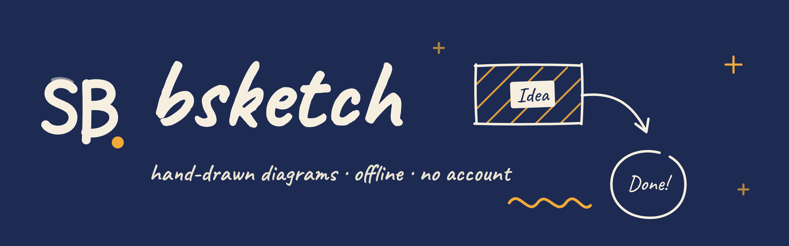
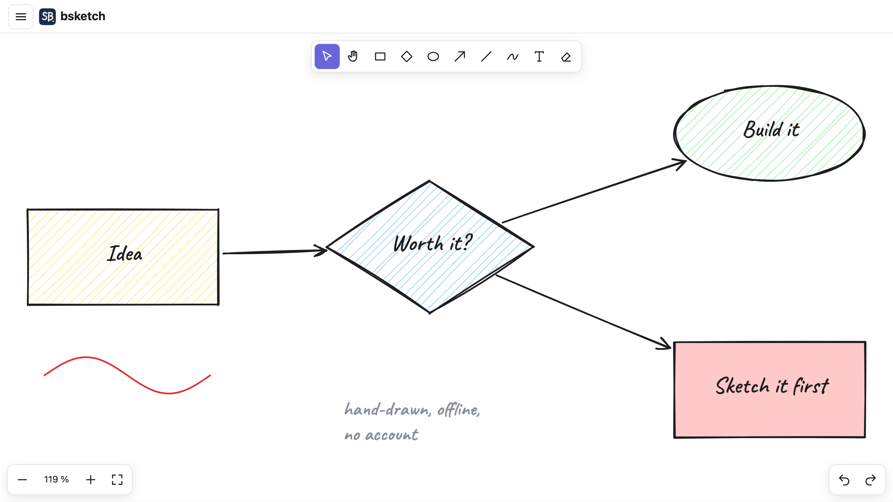

<div align="center">



**A hand-drawn whiteboard that never leaves your computer.**
Sketch diagrams, flows and wireframes in the browser: no account, nothing to install, nothing sent anywhere.

[**Open sketch →**](https://serbenda.github.io/sketch/)

[](https://github.com/serbenda/sketch/actions/workflows/ci.yml)
[](LICENSE)


<picture>
  <source media="(prefers-color-scheme: dark)" srcset="docs/images/screenshot-dark.png">
  
</picture>

</div>

## Why sketch
- **Private by design.** Its security policy forbids every network connection: your drawing stays on your
  machine, always.
- **Works anywhere.** In any browser, offline once opened, as a single HTML file, or as a small desktop app. Even
  on locked-down work computers.
- **Fast to draw.** A hand-drawn look, text inside shapes, arrows that stick to them, and a shortcut for everything.

## Try it in a minute
1. Open **[serbenda.github.io/sketch](https://serbenda.github.io/sketch/)**.
2. Press **R** and drag to draw a box. Double-click it and type.
3. Press **R** again for a second box, then **A** and drag from one box to the other: the arrow sticks to both.
4. Move a box: the arrow and the text follow it.
5. Open the **☰ menu** (top left): **Save** keeps a `.sketch` file; **PNG** and **SVG** export it.

Your drawing is also kept in the browser, so closing the tab doesn't lose it.

## What it does
**Drawing**
- Rectangles, diamonds, ellipses, arrows, lines, pencil and text, with a hand-drawn stroke and handwriting font.
- **Text inside shapes:** it is centered, wraps to the shape and moves, resizes and rotates with it.
- **Attached arrows:** an arrow that starts or ends on a shape stays on its outline when the shape moves.
- Hachure or solid fill, colors, stroke width, dashed lines and three levels of sloppiness.

**Editing**
- Select, move, resize, **rotate**, **group**, **align and distribute**, duplicate, reorder and delete.
- Undo and redo; zoom and pan, also with two fingers on a phone.
- Fully usable with the keyboard, with descriptions for screen readers.

**Files and options** (the ☰ menu)
- Saves and opens `.sketch` files, opens `.excalidraw` files, exports to **PNG** and **SVG**, also with a
  transparent background.
- **Appearance:** light, dark or the system's, whatever the system theme is.
- **Canvas background:** six light colours, saved with the drawing.
- Embedded in [Snowlog](https://github.com/serbenda/snowlog), where drawings are stored end-to-end encrypted and
  shown inside notes.

## Three ways to use it
| | How | Good for |
|---|---|---|
| 🌐 **Web** | [serbenda.github.io/sketch](https://serbenda.github.io/sketch/), in Chrome, Edge, Firefox or Safari. Chrome and Edge can install it as an app ("Install app") | Everyday use; works offline once opened |
| 📄 **Portable** | **Portable version** in the site's menu downloads `sketch-portable.html`: double-click it on Windows, macOS or Linux | Computers where you can't install anything. It is not a program, so antivirus tools don't block it |
| 🖥️ **Desktop** | `sketch-windows.exe`, `sketch-macos.zip` and `sketch-linux.AppImage`, built by the [Desktop workflow](https://github.com/serbenda/sketch/actions/workflows/desktop.yml) (download them from a run's artifacts) | A window of its own, no browser |

The desktop builds are not signed: on macOS, open it the first time with right click → Open; on company computers
the antivirus may block an unsigned executable (use the portable file there). They use the system's web engine
(Edge on Windows, Safari on macOS, WebKit on Linux), which the system keeps up to date.

## Shortcuts
<details>
<summary>All shortcuts</summary>

| Key | Action |
| --- | --- |
| V · H | Select · pan the canvas (or hold Space) |
| R · D · O | Rectangle · diamond · ellipse |
| A · L · P · T · E | Arrow · line · pencil · text · eraser |
| Shift | Keep proportions while drawing or resizing; 15° steps for lines and rotation |
| Ctrl+Z · Ctrl+Y | Undo · redo |
| Ctrl+D · Ctrl+C · Ctrl+V | Duplicate · copy · paste |
| Ctrl+G · Ctrl+Shift+G | Group · ungroup |
| Delete · arrow keys | Delete · move the selection (Shift: 10 at a time) |
| Ctrl+wheel · Ctrl+0 | Zoom · back to 100% |
| Double click · Enter | Write text: inside the shape when done on one (or edit the existing text) |

To rotate, drag the round handle above the selection.

Without a mouse: choose a tool with its key and press **Enter** to create the shape in the center. **Tab** and
**Shift+Tab** go through the elements, **Alt+arrow keys** resize them, **[** and **]** rotate them and **Enter**
writes inside. **Escape** clears the selection (and then Tab leaves the whiteboard).

</details>

## Privacy
- The page's Content Security Policy has `connect-src 'none'`: it **cannot** send anything over the network, not
  even by mistake. No analytics, no accounts, no server.
- No third-party code at runtime: plain JavaScript modules, no frameworks or CDNs.
- `.excalidraw` files are read as plain JSON; no Excalidraw code is used.

Found a security problem? See [SECURITY.md](SECURITY.md).

## Data sources
| Source | What it provides | License |
|---|---|---|
| None | No network calls at all | — |
| [Caveat](https://github.com/googlefonts/caveat) | The handwriting font, subset to Latin characters and served from the site | SIL Open Font License ([fonts/OFL.txt](fonts/OFL.txt)) |

## For developers
```bash
git clone https://github.com/serbenda/sketch.git
cd sketch
git switch development
python3 -m http.server 8000   # then open http://localhost:8000
npm test                      # engine tests (no dependencies)
npm run test:e2e              # walkthroughs in Chrome
```
Everything else (requirements, verifying, building the portable and desktop versions): [docs/SETUP.md](docs/SETUP.md).

<details>
<summary>Project structure</summary>

```
.
├── index.html · icon.svg · manifest.webmanifest
├── sw.js              # service worker: the site offline
├── css/styles.css     # the page
├── css/sketch.css     # the editor (sk- prefix, can be embedded)
├── js/stroke.js       # seeded hand-drawn strokes → paths for canvas and SVG
├── js/scene.js        # elements: create, measure, hit-test, move, rotate, bind, merge, open/save, .excalidraw
├── js/render.js       # scene → canvas, SVG (text or DOM) and PNG
├── js/editor.js       # the interactive editor, mountable in any container
├── js/app.js          # the site: the side menu, open, save, export and options
├── js/prefs.js        # the site's preferences (appearance), validated
├── fonts/             # handwriting font (Caveat, OFL)
├── desktop/           # desktop version (Tauri): icon, smoke test and src-tauri/
├── scripts/           # build-portable.mjs, and the template's setup, sync and check scripts
├── tests/             # node --test; tests/e2e: walkthroughs in Chrome over DevTools, no dependencies
├── docs/              # VISION, STATE, WORKLOG, ROADMAP, phases, decisions, ARCHITECTURE, THREAT_MODEL…
├── .claude/ · .githooks/ · .github/
├── AGENTS.md          # rules for any AI agent
└── CLAUDE.md          # imports AGENTS.md and adds what is specific to Claude Code
```

How it is built: [docs/ARCHITECTURE.md](docs/ARCHITECTURE.md). What it will and won't do: [docs/VISION.md](docs/VISION.md).

</details>

<details>
<summary>How to work with Claude</summary>

Every flow, as diagrams: [docs/WORKFLOWS.md](docs/WORKFLOWS.md).

```
/status                      at the start of every session
/new-phase <what>            phase file + plan → you approve → Claude implements on development
(automatic)                  record-changes skill: WORKLOG after every change
/close-phase                 criteria + DoD + updates STATE, ROADMAP and CHANGELOG (once per phase)
/prepare-pr                  reviewers + development → main PR (you merge it)
/decision <what>             when something hard to undo has to be chosen
```

</details>

## Contributing
Read [AGENTS.md](AGENTS.md) and the [Definition of Done](docs/DEFINITION_OF_DONE.md).

## License
[MIT](LICENSE) © Sergio Santiago Bendaña Quesada
