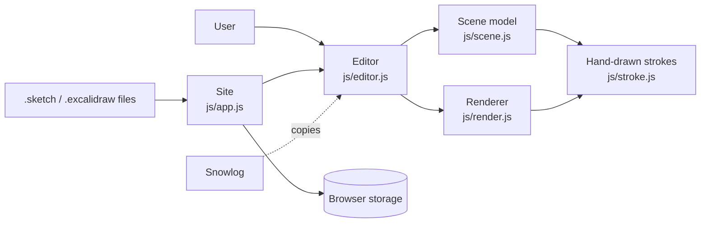

# Architecture

> How it is built, from a bird's-eye view. Update it when a piece or a flow changes, not on every commit.
> The reasons behind each choice are in [decisions/](decisions/).

## Pieces

| Piece | What it does | Technology | Folder |
|---|---|---|---|
| Stroke | Seeded wobbly paths (lines, ellipses, hachure, arrowheads) for canvas and SVG | Plain JS module | `js/stroke.js` |
| Scene | Elements and pure functions: measure, hit-test, move, resize, rotate, bindings, merge, open/save, `.excalidraw` import | Plain JS module | `js/scene.js` |
| Renderer | Scene → canvas, SVG text, SVG DOM nodes and PNG; text measuring and the handwriting font | Plain JS module | `js/render.js` |
| Editor | Toolbar, canvas, style panel, pointer and keyboard; mountable in any container | Plain JS module, DOM only | `js/editor.js`, `css/sketch.css` |
| Site | Full-screen editor, side menu (open/save/export, appearance, canvas background), browser storage, service worker | HTML, CSS, JS | `index.html`, `js/app.js`, `js/prefs.js`, `css/styles.css`, `sw.js` |
| Portable build | Everything in one HTML file with a no-network CSP | Node script | `scripts/build-portable.mjs` |
| Desktop app | A Tauri window that loads the portable file | Rust (Tauri 2) | `desktop/` |

## Data flow
- **In:** what the user draws, and files they open (`.sketch`, `.excalidraw`) or drop on the page: untrusted.
  `parseScene` validates every field (`cleanElement`) before anything uses it. The saved drawing in the browser
  (`localStorage`, key `sketch.current`) goes through the same validation. The site's preferences (`sketch.prefs`:
  the appearance) are read through `js/prefs.js`, which keeps only known values.
- **Through:** the editor keeps the scene in memory and passes immutable element objects to the renderer, which
  caches each element's strokes by object identity.
- **Out:** downloads (`.sketch`, PNG, SVG) and the browser's storage. Nothing goes over the network.
- **Snowlog** mounts the editor and stores the scene's JSON encrypted; it uses `mergeScenes` to join changes
  from two devices.

## External sources
| Source | What it provides | License | If it fails… |
|---|---|---|---|
| Caveat font (subset, in `fonts/`) | Handwriting font | SIL OFL 1.1 | Falls back to the system's cursive fonts |

## Code conventions
- Everything in English: identifiers, comments, UI texts, tests and docs.
- No runtime dependencies and no build step for the site ([0002](decisions/0002-stack-static-site-no-dependencies.md)).
  Modules use only `import { … } from './x.js'` / `import * as X from './x.js'` and `export function|const|class`
  (the portable bundler's subset).
- Elements are never mutated in place: every change creates a new object (the bounds and stroke caches rely on it).
- The editor builds its DOM with `createElement` and `textContent`; never `innerHTML`. CSS classes use the `sk-` prefix.
- Anything read from a file or storage goes through `parseScene`/`cleanElement` first.
- Unit tests in `tests/*.test.mjs` (`node --test`), browser walkthroughs in `tests/e2e/` (Chrome over DevTools).
